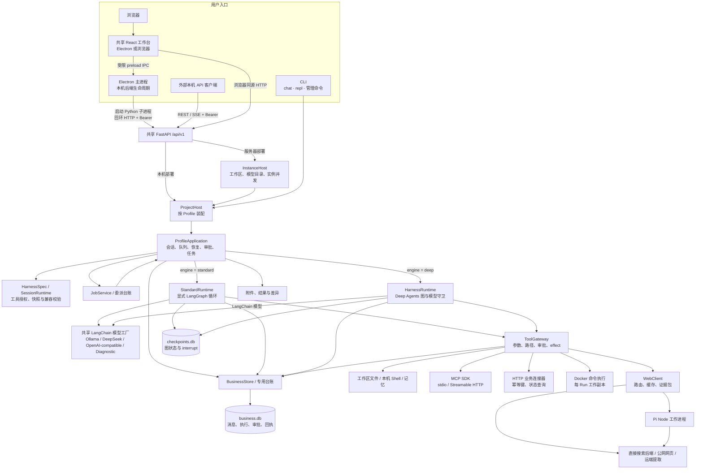
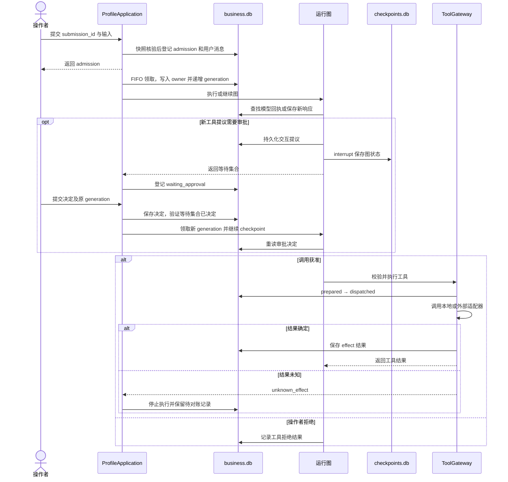
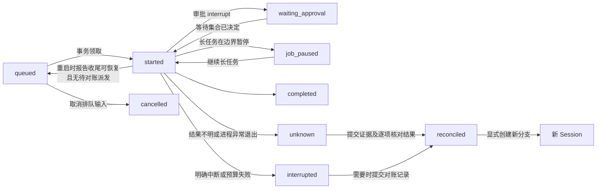

# deep-harness v1.1.8 架构与技术实现

deep-harness 是可在本机及服务器运行的通用 Agent 宿主。CLI、Windows 桌面端和同源浏览器工作台共享 Python 应用服务。一次用户输入进入业务库成为一条 admission，随后才交给运行图。模型生成工具提议，宿主决定工具是否获授权、是否需要批准、能否派发，以及结果是否需要人工对账。

应用版本、业务库 schema 12、会话快照版本 4 和能力清单版本 2 各自演进。

[Web 接口与业务扩展](IMPLEMENTATION_SPEC.md)和[单实例部署](deploy/README.md)记录服务器 Web、模型配置、Docker 隔离和业务扩展。

## 1. 系统架构

| 代码层 | 职责 |
| --- | --- |
| [`domain/`](src/deep_harness/domain) | Session、Admission、ExecutionClaim、ToolCall、ProfileScope、领域错误、模型端口和身份指纹。领域类型独立于运行框架和数据库。 |
| [`application/`](src/deep_harness/application) | Harness 与能力策略、快照、工具网关、工作区操作、长任务、知识策展和配置校验。服务通过组合调用持久化和运行适配器。 |
| [`runtime/`](src/deep_harness/runtime) | LangGraph、Deep Agents、LangChain 模型适配、上下文投影、checkpoint 审批转换与 MCP SDK。 |
| [`infrastructure/`](src/deep_harness/infrastructure) | SQLAlchemy 异步 SQLite、数据库初始化、执行与审批台账、文件锁、备份、网络适配及 Windows Job。 |
| [`transports/`](src/deep_harness/transports)、[`cli.py`](src/deep_harness/cli.py)、[`desktop/`](desktop) | CLI 参数、REST/SSE、桌面子进程协议、界面和本地连接管理。 |
| [`bootstrap.py`](src/deep_harness/bootstrap.py) | 组合根与 Profile 生命周期。当前也直接承担调度、审批唤醒、委派、取消、分支和备份编排。 |

## 2. Profile、会话与执行所有权

- **Profile** 由 `ProjectHost` 按 ID 延迟装配，运行目录为 `<state-dir>/profiles/<profile-id>`。`ProfileResolver` 解析绝对工作区，业务库持久绑定该路径。启动先获取 Profile lease 和 `owner.lock`，初始化双库后再处理恢复；关停先阻止新变更、暂停运行中的长任务并排空受管任务，再释放资源。
- **Session** 由调用方以 `request_id` 幂等创建，冻结工作区、prompt、工具集合、模型标识、运行预算、Harness、知识内容和 MCP 工具绑定。会话存储运行快照及其指纹，提交和调度前按当前协议重算并比较。状态接口返回兼容性及差异字段。权限模式可独立修订，修订号影响后续审批与复用。
- **Admission** 代表一次已接受的输入。业务库用 `submission_id` 和输入指纹处理重复提交，为会话内的输入分配顺序。单会话调度锁串行 drain；领取在事务中写入 owner 并递增 generation。关键写入检查 admission ID、owner、generation 和 `started` 状态，过期执行收到 `lease_lost`。
- **Effect** 归属于具体 admission 和工具调用。工具名及参数的指纹校验调用身份，审批和派发阶段各自落库。已完成的回执供图重放复用，已派发且结果未知的操作进入人工对账。

来源见 [Profile 组装](src/deep_harness/bootstrap.py)、[会话快照](src/deep_harness/application/session_runtime.py)、[业务存储](src/deep_harness/infrastructure/store.py)、[执行台账](src/deep_harness/infrastructure/executions.py)和[回执台账](src/deep_harness/infrastructure/receipts.py)。

### 编码任务工作区

编码任务复用会话 ID，在运行快照中冻结工作区模式与可选验收命令。Profile 仍绑定源项目。任务 checkout 由持久描述记录实际位置和 Git 基线，并用于所有轮次的工具执行。隔离任务目录位于 Profile 状态内，只有当前任务树可以通过工具网关访问。受管本地任务持有工作区租约，Docker 命令只挂载任务树。审批和外部回执仍归属于单次 admission。

源项目交付由显式操作触发，使用任务基线生成累计变更集，逐文件校验目标哈希和模式。已有派发意图但没有完成回执时，核对会读取当前文件并报告匹配状态。撤销使用交付前保存的内容。固定验收命令缺少匹配回执时，由单独的 LangGraph 检查点执行验证步骤。任务工作区、交付记录与开发进程元数据均有独立持久路径，业务 schema 保持现有契约。

交付图以操作和变更包摘要绑定检查点。Web 导出不可变清单与文件数据，本地导入对目标目录执行预检，批准后依旧由文件回执记录派发和结果。子任务的合并工具由宿主从台账取出补丁，批准的参数包含实际补丁内容。

## 3. Harness、模型与运行图

| Harness | CLI / REST 默认执行路径 | 服务端派生核心工具 | 专业行为 |
| --- | --- | --- | --- |
| `general` | `standard` | 10 个完整核心工具 | 普通会话输出 |
| `coding` | `deep` | 核心工具与编码专用工具 | 任务工作区、实现与只读调查和审查、验收和交付证据 |
| `research` | `deep` | 7 个只读核心工具 | 研究引导和结构化报告，声明 research 委派类型 |
| `research_web` | `deep` | 同一组 7 个只读核心工具 | 优先使用联网研究、补读和来源引用 |

`HarnessSpec` 声明档位属性，`derive_grants()` 派生内置工具与显式扩展，能力 API 将二者发布给客户端。CLI 与桌面以 Harness 为入口。会话运行路径由后端根据 Harness 选择。专业 Harness 要求 Deep，Deep 要求 LangChain 模型适配器，显式 diagnostic 走 Standard 路径。

新建研究会话时，CLI、REST 和桌面均从 Harness 派生只读核心工具，可显式授权扩展。

- **Standard** 用 `StateGraph` 编译 `model → tools → model` 循环，模型没有工具调用时结束。图按 session ID 保存 checkpoint。模型侧使用项目的持久上下文投影，按完整轮次归档并维护摘要；必要时缩减当前请求中的工具输出。业务 transcript 保留完整记录。
- **Deep** 由 `HarnessRuntime` 构造 `create_deep_agent()`，`agent.py` 提供 profile 注册、提示及中间件辅助函数。图使用 SDK `StateBackend`，宿主文件读取、写入和终端通过项目工具进入 `ToolGateway`。`HarnessGuardMiddleware` 围绕模型调用检查 owner、暂停点、预算及回执，工具侧的审批和回执复用位于 `HarnessRuntime._tool()`。Deep 在请求时投影消息，裁减较早轮次并优先保留当前工具交换。两套路径的快照可共享 `persisted-v2` 标签，投影算法仍各自实现。
- **模型** 默认使用本机 Ollama `qwen3.5:9b`，窗口 32768 tokens，关闭 reasoning。OpenAI-compatible 使用 LangChain 适配器。确定性 `DiagnosticModel` 用于显式诊断和离线测试。应用同时约束模型调用次数、工具调用次数、累计 token 和主动运行时间。默认每次 admission 上限为 16 次模型调用、64 次工具调用、100000 tokens 和 600 秒，审批等待期间暂停累计主动运行时间。
- **报告** 专业 Deep 会话的报告由宿主在图运行后解析和校验。Coding 先登记报告收尾检查点，使用真实命令退出码和文件 SHA-256 构造证据。格式错误时可尝试一次有时限的无工具修复，仍失败时输出 `report_status=unavailable` 及已有持久证据。

来源见 [Harness 声明](src/deep_harness/application/harness_spec.py)、[Standard 图](src/deep_harness/runtime/standard.py)、[Deep 图](src/deep_harness/runtime/deep.py)、[模型守卫](src/deep_harness/runtime/guard.py)、[上下文](src/deep_harness/runtime/context.py)和[默认配置](src/deep_harness/server.yaml)。

## 4. 输入、审批与派发时序

工具预算按 admission 和调用 ID 计数，图重放同一调用不重复扣额。审批交互绑定调用提议指纹及代际。图恢复命令只负责解除 interrupt，是否执行取决于业务库中持久化的决定。重复提交原决定可重新唤醒等待会话，冲突决定被拒绝。执行派发事务再次检查授权及当前权限修订号。

### 权限矩阵

| 模式 | 普通工作区读取 | 普通工作区写入与命令 | 工作区外、敏感路径、Web、MCP、持久记忆 |
| --- | --- | --- | --- |
| `ask` | 免批 | 逐项 | 逐项 |
| `auto` | 免批 | 同 admission、同作用域复用，可撤销。多文件补丁逐项批准 | 逐项 |
| `full` | 免批 | 免批 | 在允许访问的边界内免批，记录适用的豁免审计 |

`full` 需要显式风险确认，工具仍须在会话授权集合中。文件路径校验拒绝宿主运行状态目录。Shell 使用当前系统用户权限运行，覆盖范围取决于该用户的 OS 权限。Electron 渲染沙箱只作用于界面进程。研究档位的只读约束覆盖内置工具，显式 MCP 工具的远端行为由所配置的服务决定。

### 恢复和对账

启动检查业务状态和图 checkpoint，恢复可领取输入以及已决定的审批等待。原状态为 `started` 的 admission 只有在存在报告收尾记录且没有未确认的派发时才重新排队，其余进入 `unknown`。已派发但未完成的操作可能在数据库提交与外部响应之间中断，系统无法凭 checkpoint 推断外部动作是否完成。对账请求需给出原 generation、每项未决 effect 的指纹、实际结果及证据。对账后原会话保留阻塞状态，显式分支复制起始的连续已完成轮次并建立新会话。

来源见 [权限分类](src/deep_harness/application/permissions.py)、[工具派发](src/deep_harness/application/tools.py)、[审批 checkpoint](src/deep_harness/runtime/approval_checkpoint.py)、[对账](src/deep_harness/infrastructure/reconciliation.py)和[分支](src/deep_harness/infrastructure/branches.py)。

## 5. 持久化、查询与备份

| 存储 | 主要记录 | 责任 |
| --- | --- | --- |
| `business.db` | `sessions`、`admissions`、`messages`、`events`、`session_policies`、`session_branches` | 对话、执行身份、快照、事件与分支 |
| `business.db` | `tool_attempts`、`model_receipts`、`effects`、`interactions`、审批等待、决定、撤销及 `resolutions` | 工具预算、回执、审批和未知结果对账 |
| `business.db` | `delegations`、`jobs`、`job_stages`、`job_stage_attempts`、技能、记忆、策展和上下文表 | 任务归属、知识版本及上下文归档 |
| `checkpoints.db` | LangGraph thread、状态、待恢复节点和 interrupts | SDK 图恢复，普通会话以 session ID 为 thread ID |

业务库采用 SQLAlchemy async、aiosqlite、WAL 和显式事务。业务库与 SDK checkpoint 各自提交，应用通过台账、稳定标识、代际检查和启动恢复处理跨库间隙。事件按递增序号分页，历史消息支持最近页、向前翻页和实时增量。搜索用全文索引与字面匹配保留中文子串查询，事件、消息、admission、回执与 effect 的高频查询使用专用索引。

启动时用 `PRAGMA user_version` 验证当前业务 schema，空状态目录初始化新库。Profile 归档先进入维护屏障并等待受管操作排空，再将双库和 Profile 文件打包，写入哈希清单。还原校验归档结构、文件摘要和 SQLite 完整性，再落入未使用的 Profile 目录。

来源见 [业务 schema](src/deep_harness/infrastructure/schema.py)、[存储查询](src/deep_harness/infrastructure/store.py)、[数据库初始化](src/deep_harness/infrastructure/database.py)和[归档](src/deep_harness/infrastructure/archives.py)。

## 6. 工具及外部集成

| 能力 | 技术实现 |
| --- | --- |
| 工作区读与搜索 | `read` 返回 UTF-8 内容、SHA-256 和行列游标。目录扫描跳过常见状态、构建和依赖目录，限制扫描量及输出。快照 v4 的 `search_files` 返回跨页游标及截断原因。 |
| 写入、编辑与补丁 | 同目录临时文件、刷新和原子替换。覆盖已有文件需基线哈希，`edit` 先精确匹配，必要时经 LF/CRLF 归一化定位唯一范围并保留 BOM。显式扩展 `apply_patch` 在写入前重新核验各文件及 hunks，逐文件记录进度。部分落盘后的失败需要对账。 |
| 终端 | `bash` 根据平台选择 PowerShell 或 Bash，设置工作目录与精简环境，双流持续排空并限制保留量。超时或取消时清理进程组或 Windows Job。 |
| 联网 | `web_search` 查候选，`web_fetch` 按页读正文，`web_extract` 批量读，`web_research` 在总时限内并发查询、评分去重、补抓和归并引用。Profile 共享并发限制、TTL 缓存和在途合并。公网直抓检查解析地址与重定向，限制大小和时间。正文用不可信内容包装进入工具结果。 |
| Pi 搜索 | 默认 Pi 优先走 Exa、Parallel；Python 负责外层可用性筛选和回退。每个启用的 Profile 按需复用 Node 工作进程，经 stdio JSON Lines 通信。搜索工作进程负责供应商搜索，正文读取和证据打包留在 Python。 |
| MCP | Profile 显式配置 stdio 或 Streamable HTTP 连接，支持客户端凭据 OAuth。发现时分页读取工具目录，冻结 schema 指纹；调用前在连接上重新校验目录与参数。通过网关登记派发后才调用远端，远端结果不明时走对账。 |
| 技能与记忆 | 技能由带元数据的 Markdown 维护，技能和记忆从 Profile 取有界快照注入新会话。模型通过显式扩展申请保存记忆。独立策展流程生成候选，操作员接受后才写入记忆。 |

来源见 [工作区搜索](src/deep_harness/application/workspace.py)、[原子文件](src/deep_harness/application/atomic_files.py)、[补丁](src/deep_harness/application/patches.py)、[Shell](src/deep_harness/application/shell.py)、[WebClient](src/deep_harness/infrastructure/web/client.py)、[Pi 工作进程](web-worker/search.ts)、[MCP](src/deep_harness/runtime/mcp.py)和[知识存储](src/deep_harness/infrastructure/knowledge.py)。

## 7. 长任务和委派

**长任务**由 `JobService` 和 `JobLedger` 调度。提交计划后按阶段创建独立会话及稳定的输入标识。任务预算先按阶段分配，再与单 admission 的限制取较小值。同组允许规则约束下的最多两路只读阶段，跨组按顺序推进，阶段模型调用共享应用内的一把锁。后续阶段接收有界的已完成报告与引用。可配置最终独立验收命令，验收读取实际工具回执、退出码，以及受管写入和命令的顺序。暂停在后续模型或工具边界落 checkpoint，未知、未验证或中断的阶段由调度器标为需要处理。

**委派**由显式授权的 `delegate_task` 和 `check_delegation` 驱动。同步委派构造带独立图 thread 的子运行实例，使用父 admission claim、预算及受限工具交集，子审批向父图传递。后台委派经宿主创建独立会话和 admission，有自己的执行预算，支持查询、追加指令和停止。委派类型由 HarnessSpec 声明，运行时使用专用提示和持久台账。

来源见 [长任务编排](src/deep_harness/application/jobs.py)、[长任务台账](src/deep_harness/infrastructure/jobs.py)、[同步委派](src/deep_harness/runtime/deep.py)和[委派台账](src/deep_harness/infrastructure/delegations.py)。

## 8. 桌面连接、配置和发布

- Electron 主进程启动选定 Python，生成会话 Bearer token，经 stdin 交给后端，从 stdout 读取回环端口，再通过 `/health` 完成连接验证。渲染进程启用 context isolation、关闭 Node 集成，经 preload 调用限定 IPC。主进程验证调用来源并将路由限制在当前 Profile。
- Electron 与 Web 构建同一份 React 工作台。共享状态层以增量轮询更新消息、事件和审批，游标与切换代号避免旧请求覆盖新会话。REST 另外提供可续传 SSE。提交响应丢失时可按原 submission ID 查询接收状态。
- Python 3.12 使用独立 Conda 环境。Python 直接依赖声明在 `pyproject.toml`，精确版本记录在 `requirements.lock`，Windows Conda 环境另有锁文件。本基线锁定 Deep Agents 0.7.32、LangGraph 1.2.19、LangChain 1.4.7、FastAPI 0.162.0、SQLAlchemy 2.1.6。
- 包内 `server.yaml` 提供默认值，进程级 `DEEP_HARNESS_SERVER_CONFIG` 合并部署覆盖，`--config` 接受 YAML/TOML 的启动配置，CLI 显式模型参数进一步覆盖模型配置。凭据从环境变量读取。
- 桌面用 TypeScript、React、Nanostores 和 esbuild，electron-builder 生成 Windows 便携包，内含 Pi 工作进程。运行后端仍依赖选定的 Python 环境和所配置的模型服务。

来源见 [Electron 主进程](desktop/electron/main.ts)、[本地连接](desktop/electron/runtime.ts)、[桌面状态](desktop/src/state.ts)、[REST API](src/deep_harness/transports/api.py)、[服务端配置](src/deep_harness/server_config.py)和[版本锁](requirements.lock)。

## 9. 当前实现边界与验证

| 领域 | 当前边界 |
| --- | --- |
| 执行框架 | 专业档位走 Deep，通用档位默认走 Standard。Deep 使用请求级上下文投影，图内文件使用 SDK `StateBackend`。Standard 使用持久整轮归档。 |
| 可靠性 | 双库、模型回执和工具台账提供可追踪的恢复边界。外部调用的实际结果可能早于回执持久化，出现未知结果时由人工对账。 |
| 工作区 | 文件工具受路径和哈希约束。本地 Shell 使用当前用户权限，Web Shell 在配置的 Docker 工作区运行。搜索按文件扫描，多文件补丁逐文件原子替换。 |
| 部署 | Web 单 worker 持有实例状态卷。每个 Profile 由独立 owner 持有。Web 访问范围由部署网络界定，访问者共享实例状态和操作能力。 |
| 实验集成 | Pi 搜索受供应商、公网和本机 Node 运行条件影响。显式启用的第三方 MCP 和远端提取由所配置服务决定运行范围。 |

后端通过专用 Conda Python 3.12 运行 `scripts/run_tests.sh`。桌面通过 `npm test` 验证本机 Python 连接、审批和重启恢复，通过 `npm run typecheck` 检查类型。离线模型及本机集成、真实 Ollama、公网供应商和全新 Windows 便携包分别验收。[开发状态](DEVELOPMENT.md)
