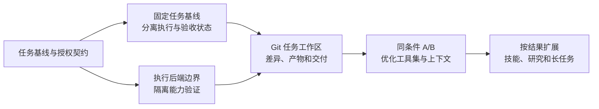

# deep-harness v1.1.3 技术评审与优化路线

评审日期为 2026-11-22，源码以当前工作树为基线。[架构说明](ARCHITECTURE.md)记录当前分层与执行流程。本评审结合本地源码，以及各产品公开文档与研究资料。产品对比覆盖公开的行为和接口。各产品的任务成功率、运行成本、内部权限实现及崩溃一致性需要单独实测。

## 结论

deep-harness 已经具备作为本地 Agent 宿主的核心基础。Profile 有单 owner，admission 有 generation fencing，审批与副作用分别落库，已派发且结果未知的操作进入人工对账。加上本地 Ollama、冻结快照和研究证据包，这些能力构成了可以持续演进的底座。

最值得提升的是 **工作结果可验收，执行范围可隔离**。目前项目能回答“这次工具调用有没有获批、派发或留下回执”，对“现在的工作树是否通过了预先定义的验收、这项修改是否影响了用户原有工作”的回答还不完整。建议优先完成一条从隔离工作区到可复核产物的 Coding 路径，再把同样的证据机制扩展到研究。

## 1. 六个产品的设计取舍

| 产品 | 公开的关键机制 | 对 deep-harness 的启发 |
| --- | --- | --- |
| **OpenAI Codex** | 桌面托管 Git worktree、变更审阅和任务引导。执行沙箱与批准策略是独立控制。OpenAI 的仓库工程实践将可启动环境、日志、测试和仓库说明作为 Agent 的反馈来源。 | 建立每任务工作区、基线和差异审阅。保留现有审批台账，另设由执行环境强制实施的边界。让项目可被 Agent 独立启动和验证。 [Worktrees](https://learn.chatgpt.com/docs/environments/git-worktrees) · [Codex 沙箱](https://openai.com/index/inside-the-codex-sandbox/) · [Harness engineering](https://openai.com/index/harness-engineering/) |
| **Claude Code** | 生命周期 hooks 支持在工具前后及结束等阶段接入逻辑。文件变更 checkpoint 可和会话一起回退，覆盖其文件编辑工具。Bash 沙箱支持文件和网络约束，平台支持及策略配置影响实际边界。 | 在宿主工具和交付边界提供少量类型化检查点。把会话恢复、受管文件恢复、外部副作用对账分别建模，并在界面标出各自覆盖范围。 [Hooks](https://code.claude.com/docs/en/hooks) · [Checkpointing](https://code.claude.com/docs/en/checkpointing) · [Sandboxing](https://code.claude.com/docs/en/sandboxing) |
| **腾讯 WorkBuddy** | 办公任务以项目、技能、连接器、结果与产物组织。公开文档覆盖定时运行、归档产物，以及特定场景下的 Git 并行开发和自动备份。 | 将“产物”提升为任务详情的一等对象，显示来源、最近验证和可打开的位置。优先做本地产出与审阅，定时和连接器市场可在执行边界成熟后评估。 [产品介绍](https://www.codebuddy.cn/docs/workbuddy/From-Beginner-to-Expert-Guide/Product-Guide) · [定时任务](https://www.codebuddy.cn/docs/workbuddy/From-Beginner-to-Expert-Guide/Function-Description/Automation-Guide) · [Git 并行](https://www.codebuddy.cn/docs/workbuddy/From-Beginner-to-Expert-Guide/Function-Description/Worktree-Task) |
| **DeepSeek Harness** | 可查源码，以 Cordis 插件机制组织能力，公开提供桌面、Web 和扩展接口，支持查看轨迹、工具调用及执行细节。Agent Teams 在产品页标为实验能力。 | 先固定可扩展边界和轨迹格式。第三方能力可通过声明式注册接入，同一份授权与派发契约继续归宿主管理。 [官方产品页](https://www.deepseek.com/harness/en/) · [官方仓库](https://github.com/deepseek-ai/deepseek-harness) |
| **Nous Hermes Agent** | 侧重持续运行的个人助手。提供按需技能、跨会话记忆、消息网关、定时任务与轨迹导出。 | 学习“需要时加载技能”和可重复使用的轨迹。保留项目已有的人审策展，再增加来源、写入原因和撤回能力。 [Hermes 官方文档](https://hermes-agent.nousresearch.com/docs) · [技能系统](https://hermes-agent.nousresearch.com/docs/user-guide/features/skills/) |
| **Pi Agent** | 轻量 coding loop、多模型切换、可扩展压缩、会话树、steering 和 SDK 接入。可按工作流定制扩展与装配。 | 针对本地 9B 模型测量精简提示和工具 schema 的效果，按需呈现工具。会话树设计可用于回看和比较，工作区 Git 分支仍单独跟踪。项目现有 Pi Node worker 只复用搜索扩展的供应商路由。 [Pi 官方文档入口](https://pi.dev/) · [本项目工作进程](web-worker/search.ts) |

## 2. 已确认缺陷与优先级

### P0：宿主审批与 OS 执行边界之间存在空档

当前工具授权、敏感目录判断、环境变量收缩、Windows Job 和进程组清理各有作用。Shell 在当前用户权限下运行。目录参数仅决定启动位置，Electron 渲染沙箱也只保护界面进程。因而“工作区内的命令批准”无法在 OS 层约束命令读取哪些文件、向哪里写或是否发起网络请求。Git worktree 解决并行修改和差异审阅，文件和网络约束需要独立执行边界。

**改进**。定义小型 `ExecutionBackend` 接口，显式报告隔离能力。先做一个可验证的隔离后端，原生 Windows 路径需要单独验证文件与网络限制，亦可针对合适环境使用受控 VM 或容器。隔离不可用时显式标记，已承诺隔离的请求应停止。让审批界面分开展示实际执行环境、可访问工作区和网络策略。用临时目录与可控测试端点验证授权范围、子进程继承和停止行为。来源见 [Shell](src/deep_harness/application/shell.py)、[权限分类](src/deep_harness/application/permissions.py)、[Windows Job](src/deep_harness/infrastructure/windows_job.py)。

### P1：Coding 的“已完成”与“已验证”语义混在一起

普通 Deep Coding 会话在报告格式修复失败后可以输出 `report_status=unavailable` 并把 admission 记为完成。长任务可要求命令证据，并约束命令顺序、退出码和可选命令文本，已有明确进展。其文件证据来自工具消息中的哈希，不能证明 Shell 或外部编辑后的最终工作树仍与当时的回执一致。若阶段未配置具体命令，满足现有条件的零退出命令也只能证明该次命令成功。

**改进**。把执行状态、报告状态和验收状态独立呈现。新增可选版本化验收规则，任务开始时冻结命令、工作区基线和允许的产物范围，宿主在结果快照上运行或核对验收。将命令、退出码、工作树差异和产物摘要绑定到同一次验证。验证后工作树变化时标为过期。需要人工接受时记录独立决定。优先用现有 `coding_evidence()`、命令回执和 JobService，避免再造调度器。来源见 [Coding 报告](src/deep_harness/runtime/deep.py)、[阶段验证](src/deep_harness/application/jobs.py)、[Coding 证据](src/deep_harness/application/coding_evidence.py)。

### P1：会话分支与文件交付缺少连接

`BranchLedger` 复制连续已完成的对话轮次，文件副作用仍存在于同一个工作区。原子写、基线哈希和补丁回执可判断单个文件的变化，缺少每任务 Git 基线、变更范围预览和用户可审阅的交付。多文件补丁在部分写入后仍需人工对账。

**改进**。先交付显式的 Git 任务工作区模式，保存原始基线、任务工作树、变动文件和可打开的 diff。用户可审阅并选择应用。非 Git 工作区保留已有网关，逐步增加受管变更清单。验收覆盖有未提交文件的源工作树、两个并行任务、停止后可审阅差异，以及源工作树在任务期间无变化。来源见 [会话分支](src/deep_harness/infrastructure/branches.py)、[文件原子写](src/deep_harness/application/atomic_files.py)、[补丁执行](src/deep_harness/application/tools.py)。

### P1：双运行时的共享语义与上下文需要收口

Standard 能持久归档整轮历史并在必要时裁缩工具输出。Deep 在请求时寻找保留轮次，旧轮主要保留用户输入摘要，当前轮或工具 schema 本身过大时会中断。共用 `persisted-v2` 标签掩盖了实现差异。Standard 模型路径还显式写入 `model.delta` 事件，Deep 守卫主要沿模型开始及最终回执路径工作。当前框架特定代码直接参与模型回执摘要与恢复，直接替换运行图会增加运行契约变更风险。

**改进**。先定义框架无关的模型请求投影、预算和语义事件契约，保留两个 runner。对新会话试验结构化交接记录，保存目标、已完成步骤、关键回执、修改文件和未决事项。保留当前工具调用与对应结果、保留证据引用，对大输出使用有界摘要或按需读取句柄。按模型测量提示与工具 schema 开销，并比较默认全工具集与按任务选择后的实际成功率。来源见 [Standard 运行图](src/deep_harness/runtime/standard.py)、[持久投影](src/deep_harness/runtime/context.py)、[Deep 守卫](src/deep_harness/runtime/guard.py)、[模型增量](src/deep_harness/runtime/inference.py)。

### P1：契约测试充分，实际任务能力缺少可重复基线

Windows 离线验证，覆盖审批、崩溃恢复、工具和传输。网关能拒绝错误输入，工具成功率仍需要独立度量。当前仓库证据能支持离线契约结论，真实模型下的整体解题率和同类产品排名需要独立评测。

**改进**。建立独立运行的任务评测入口。用临时仓库和固定证据输入覆盖单文件 LF/CRLF、多文件变更、中断恢复、长任务验收、研究引文。记录成功率、误报完成率、审批次数、token、工具调用、用时和待对账数量。加入可控故障注入核对重复派发为零。选定模型、预算、任务、工具许可和环境后做成对 A/B，至少报告重复运行结果与分母。商业产品使用自身模型和默认设置的体验测试单独呈现。来源见 [测试入口](scripts/run_tests.sh)、[开发记录](DEVELOPMENT.md)、[Anthropic 评测方法](https://www.anthropic.com/research/demystifying-evals-for-ai-agents)、[Deep Agents 的 Harbor 评测](https://www.langchain.com/blog/how-we-benchmark-deep-agents)。

### P2：研究、技能和轨迹具备基础，仍可缩短证据链

工作区搜索有扫描上限和续页游标，缺少明确的代码符号检索。Web 已有并发搜索和来源去重，证据多以有界文本传入模型。技能与记忆在会话创建时冻结，策展已有人工接受。后续可优先试验用稳定 ID 引用工具产物和来源，再按需加载技能正文。研究验收可核验引用是否落在本次证据集合，以及结论是否可追溯到抓取到的正文或供应商摘要。轨迹应可导出、可脱敏，并区分模型提议、实际运行和用户决定。来源见 [目录检索](src/deep_harness/application/workspace.py)、[WebClient](src/deep_harness/infrastructure/web/client.py)、[知识存储](src/deep_harness/infrastructure/knowledge.py)、[策展](src/deep_harness/application/curation.py)。

## 3. 2026 年 Harness 技术与本项目的落点

| 公开设计经验 | 应用于 deep-harness |
| --- | --- |
| **会话、执行编排、工具环境分离**。Claude Managed Agents 的公开设计把可恢复会话、模型循环和 sandbox 分开，OpenAI 的 Agents API 也公开了 harness 与 sandbox 的接口关系。 | 现有双库保留。把 Shell/MCP 等执行副作用的环境信息从权限策略中独立出来，给图框架和工具环境分别建立可替换接口。 [Anthropic Managed Agents](https://www.anthropic.com/research/managed-agents) · [OpenAI Agents API](https://developers.openai.com/api/docs/guides/agents-api/architecture) |
| **跨窗口依赖可读交接与实际环境**。长任务设计研究使用进度记录和增量验收，OpenAI 的仓库实践把 worktree 可启动、日志与测试视为反馈来源。 | 在目前阶段摘要上补齐任务目标、产物引用、验证结果和未决问题。将 repo 入口、启动方式和测试规范固化为可检索的项目约定。 [长任务 Harness 研究](https://www.anthropic.com/research/effective-harnesses-for-long-running-agents) · [OpenAI 仓库工程实践](https://openai.com/index/harness-engineering/) |
| **规划、执行和核查可分别预算**。2026 年 10 月的一篇预印本把原始目标、可修订计划和执行记录分开，并结合轨迹、延迟和成本评价；其结果取决于配置和任务。 | 本地 9B 的常规修改先走单 Agent 和确定性验证。只有复杂任务或验收失败时再比较独立 reviewer 带来的收益与额度消耗。 [预印本](https://arxiv.org/abs/2610.25568) · [Anthropic 长应用研究](https://www.anthropic.com/research/harness-design-long-running-apps) |
| **以最终状态评测 Agent**。Harbor 任务将环境、指令与评测脚本分开，LangChain 使用固定环境评测 Deep Agents 的执行结果。 | 先建项目自己的小型可重复评测，与确定性回归测试分开运行。外部基准作为补充，按任务和版本报告，并保留 Windows 实际发布路径的验收。 [LangChain 端到端评测](https://www.langchain.com/blog/how-we-benchmark-deep-agents) · [Harbor Terminal-Bench 示例](https://github.com/harbor-framework/docs/blob/main/examples/terminal-bench.mdx) |

## 4. 推荐实施顺序

1. **先固定授权契约**。以 CLI 和 REST 一致派生授权、现有审批可恢复和未知 effect 继续待对账为门槛。
2. **建立可验收的 Coding 基线**。对固定样例绑定工作树状态、最终验证和产物。区分执行结束、验证通过和手工接受。发布首份同模型评测结果。
3. **增加受控任务工作区**。交付可验证的隔离执行后端、Git 差异审阅与显式交付。验证并发任务之间的工作区隔离、源工作树保护及异常停止后的可追溯性。
4. **用评测驱动运行时收敛**。将两条运行路径放在同一契约测试下，按结果改造上下文、工具选择和轨迹。插件市场、常驻定时与原生 Agent Teams 在前述契约稳定后分别评估。

建议下一轮最小交付为 **一个可重复的 Coding 验收样例与可验证的执行后端**，为后续 Git 工作区和上下文优化建立可比较的基线。
