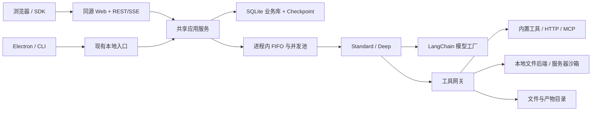

# deep-harness 免登录通用 Harness 落地实现规格

本文记录 v1.1.4 的接口、存储、启动、执行规则和验收范围。部署时可从[实例配置样例](examples/instance.yaml)开始，HTTP 字段以 Web 服务生成的 OpenAPI 为准。

## 1. 首版约束与总体结构

- 本地 CLI 和 Electron 继续共用 Python 本机服务。新增免登录 Web 模式，浏览器与 REST/SSE 同源。所有可访问客户端共享实例内的会话、运行记录和审批能力。
- 服务端首版使用一个 Python 进程、一个 Uvicorn worker、一个实例状态卷和 SQLite。现有 Profile 是内部状态分区和工作目录绑定，Web 上显示目录名称。新增实例 owner 锁，确保一个状态卷由一个 Web 实例持有。每个 Profile 继续使用原 owner 锁。
- 模型与工具按实例配置。用户可以在会话创建时指定模型和已登记目录。业务扩展通过声明式 Agent、注册工具、长任务工作流和验收器完成。
- 工作区默认只读。配置的业务写入须审批，沙箱工作区可以开放隔离命令。



## 2. 启动、配置和进程生命周期

新增 CLI 子命令，例如 deep-harness --state-dir ./state web --instance-config ./instance.yaml。保留现有全局参数和 serve 子命令。业务配置由新的 InstanceSettings 加载，现有 server.yaml 继续提供系统默认值。

```yaml
web:
  host: 127.0.0.1
  port: 8765
  trusted_hosts: [127.0.0.1, localhost]
  public_origin: http://127.0.0.1:8765

limits:
  active_runs: 4
  queued_runs: 64
  max_upload_bytes: 16777216

workspaces:
  reference:
    path: D:/agent-data/reference
    mode: read_only

models:
  local-qwen:
    adapter: ollama
    base_url: http://127.0.0.1:11434
    model: qwen3.5:9b
    capabilities: [text, streaming, tool_calls]
    context_window_tokens: 32768
    request_timeout_seconds: 180
    concurrent_requests: 1

default_workspace: reference
default_model: local-qwen
```

**加载规则**。先解析并严格校验配置，再验证目录、模型别名、引用和能力组合，最后获取实例 owner 锁、打开已登记 Profile、恢复队列并开始监听。每个会话选择一个已登记目录，纯对话可在已登记的空目录中运行。状态、配置和密钥路径受宿主文件工具保护。

模型参数采用适配器白名单字段。远程模型条目增加 secret_env 或 secret_file，配置仅保存引用。服务启动后配置只读，应用配置变更由运维重启生效。重启前检查仍有待恢复的会话绑定，保留对应的模型配置修订。关闭时停止接收新输入、按现有 grace 规则排空，释放可安全释放的槽，并在持久化后关闭模型客户端、工具连接与数据库，再释放 owner。

**部署入口**。默认监听回环。部署者通过 SSH 隧道或可信内网访问，反向代理部署时配置对外 host 与 origin，代理关闭 SSE 缓冲并合理配置读超时。Web 模式验证 Host，浏览器有 Origin 的状态变更请求必须同源，拒绝跨站浏览器请求，JSON 状态变更路由拒绝简单表单请求。程序化客户端可以通过可信网络按 API 契约提交。附件上传单独校验同源，避免可跨站提交的上传表单成为变更入口。Electron 的本机进程 token 继续留在本地传输层。

## 3. 模块职责与关键接口

| 模块 | 目标实现 |
| --- | --- |
| [bootstrap.py](src/deep_harness/bootstrap.py) | 保留 ProjectHost 和 ProfileApplication 的业务入口。抽出共享装配、实例调度与模型解析，local 和 web 两套启动参数共用应用服务。 |
| application/instance_config.py | 解析 InstanceSettings、模型和目录定义，执行引用及路径校验，公开经过脱敏的实例目录。 |
| [runtime/model_factory.py](src/deep_harness/runtime/model_factory.py) | 模型目录、修订解析、惰性构造与复用。统一使用 [LangChainModel](src/deep_harness/runtime/models.py) 调用供应商适配器。 |
| [application/session_runtime.py](src/deep_harness/application/session_runtime.py) | 保存模型绑定与 Agent 定义修订。根据已冻结配置验证和重建运行，输出安全的状态诊断。 |
| transports/web.py、[transports/api.py](src/deep_harness/transports/api.py) | Web 应用装配、静态资源、同源边界与 Web 版路由。提取共享 DTO 和服务函数，保留本机 adapter。 |
| [desktop/src/web](desktop/src/web)、[desktop/src](desktop/src) | 浏览器与 Electron 使用各自的客户端及 React 页面，共用构建入口和后端应用服务。 |
| [application/instance.py](src/deep_harness/application/instance.py)、[runtime/workflow.py](src/deep_harness/runtime/workflow.py) | 实例宿主、Agent 定义、受限工具注册、确定性步骤和 JSON Schema 验收。 |
| [application/jobs.py](src/deep_harness/application/jobs.py) | 复用长任务、阶段会话、预算、暂停和报告。增加工作流版本、确定性步骤和产物引用。 |
| [application/tools.py](src/deep_harness/application/tools.py)、[runtime/sandbox.py](src/deep_harness/runtime/sandbox.py) | ToolGateway 负责校验、审批和 effect。服务器命令进入每 Run 独立的 Docker 工作副本。 |
| infrastructure/artifacts.py、[schema.py](src/deep_harness/infrastructure/schema.py) | 文件流式收集、状态变化与索引、运行关联、原子发布、清理和备份。 |
| deploy/、examples/ | 单机启动和反向代理示例、只读 Agent、业务读写示例及事件订阅客户端。 |

关键接口形状如下。类型名称为实现建议，框架对象留在适配层。

```text
InstanceHost.start(settings) -> InstanceHost
InstanceHost.resolve_workspace(workspace_id) -> ProfileApplication
ModelCatalog.resolve(model_id, revision?) -> ModelBinding
ModelFactory.open(binding, credentials) -> ModelPort
SessionService.create(request_id, workspace_id, model_id?, agent_id?) -> SessionRef
RunService.submit(session_ref, submission_id, input, artifact_ids) -> RunRef
RunService.decide(run_ref, approval_id, generation, proposal_hash, decision)
ToolRegistry.resolve(tool_id, version) -> ToolSpec
ToolAdapter.invoke(arguments, effect_id, execution_context) -> ToolResult
ToolAdapter.reconcile(effect_id, external_ref?) -> ReconciliationResult
ArtifactStore.commit(run_ref, staged_file, metadata) -> ArtifactRef
Verifier.evaluate(expected, artifacts, receipts) -> VerificationResult
```

## 4. 存储与数据模型

首期继续复用当前数据库表及其作用。Web DTO 的 run_id 映射现有 admission ID，保持单一运行真相。

| 数据 | 持久化规则 |
| --- | --- |
| 模型目录 | 首版从 YAML 读取。配置项的稳定 ID 和不可变内容摘要作为修订。用于恢复的非密钥参数组成可持久化的模型绑定。 |
| 会话定义 | 在现有 session_policies 快照内加入 workspace_id、model_binding、agent_revision 或等价字段。密钥保存引用，使用时解析。 |
| 输入与任务 | 使用 sessions、admissions、jobs、job_stages 和 job_stage_attempts。保存提交摘要，业务事务保证重复提交稳定。 |
| 消息、事件与模型用量 | 保持 messages、events、model_receipts。增加安全的模型标识、耗时、结果类别、估算或实际用量字段。 |
| 审批、工具和外部结果 | 保留 interactions、approval_waits、approval_decisions、effects 与 resolutions，扩展 effect 的外部操作引用与结果分类。 |
| 产物 | 新建 artifacts 表，至少含 id、session_id、admission_id、storage_key、name、media_type、size、sha256、kind、status、created_at。对 storage_key 唯一约束，按运行及创建顺序索引。 |
| 对话列表与定位 | 首版每个注册目录对应一个内部 Profile，Web 路由显式带 workspace_id。所有资源通过所属目录定位，跨目录传入不匹配资源返回 404。 |

配置和 Agent 定义不强制新增数据库表。通过源定义与规范化指纹保证修订稳定。后续需要 UI 编辑时再增加配置修订表。实例目录无租户隔离语义。

**Schema 处理**。核心业务库使用 schema 12。Web 宿主初始化专用产物索引表。服务器使用独立状态目录，数据库格式由宿主校验。

## 5. 模型、会话与恢复

### 5.1 统一模型构造

1. 将 CLI 里的 provider 条件分支移到 ModelFactory，保留现有 ChatOllama、ChatOpenAI 和诊断模型。DeepSeek 使用专用 LangChain 集成，千问使用兼容端点。新增包经项目专用 Conda 环境、依赖脚本与锁文件登记。
2. 将模型声明的上下文预算传入宿主模型包装。供应商端参数和宿主 token 或字符预算分别建模。
3. Session 创建时校验所选模型是否有 Agent 所需能力。上下文窗口、工具调用、流式工具参数、结构化输出及供应商状态续传按配置和测试验证。
4. 首版连接实例可按 adapter、provider 端点、型号、配置修订和凭据生命周期复用。Standard 和 Deep 共用归一错误、超时、取消、并发和用量规则。
5. 按模型回执记录实际模型与配置修订。密钥轮换无需改变模型身份。更换实例默认值不影响原绑定。若所需端点、配置或凭据不可用，Run 停在可诊断状态，恢复时继续使用原绑定。切换模型通过新会话或显式创建新绑定分支。

### 5.2 会话幂等与模型探针

创建会话以 workspace_id 加 request_id 去重，对比模型、Agent、prompt 与授权工具的规范化摘要。相同请求返回原会话，重用键但参数改变返回 idempotency_conflict。验证模型时先完成一轮文本，再完成工具提议、回传及下一轮回答。公开目录只提供 model_id、显示名、能力与就绪状态，连接地址和密钥不进入浏览器 DTO。真实供应商探针显式运行，自动化测试走确定性模型和本机假端点。

## 6. API 契约与 Web 前端

服务器接口以 /api/v1 为前缀。在下表中，工作区资源路径使用 /workspaces/{workspace_id} 作为前缀。全局目录端点可直接读取。

| 方法与路径 | 关键字段或行为 |
| --- | --- |
| GET /instance、/models、/agents、/workspaces | 脱敏目录、默认值、可用能力、实例状态。 |
| POST /workspaces/{workspace_id}/sessions | request_id、model_id、agent_id 或 harness。返回 session_id 和绑定摘要。 |
| GET /sessions、/sessions/{id} | 会话列表以游标分页，明细给当前绑定、最近运行和待审批。 |
| POST /sessions/{id}/runs | submission_id、text、artifact_ids。202 返回 run_id 和初始状态。 |
| GET /runs/{id}、/runs/{id}/events | 当前状态、用量和产物，或按 Last-Event-ID 订阅 SSE。 |
| POST /runs/{id}/approvals/{approval_id}/decision | decision、generation、proposal_hash。固定原提议，只接收批准或拒绝。 |
| POST /runs/{id}/cancel | 受理取消，运行最终状态由事件确认。 |
| GET /runs/{id}/artifacts、GET /artifacts/{id} | 产物列表、元数据及按 ID 下载。 |
| POST /sessions/{id}/attachments | 显式上传至该会话，限制大小、数量和类型，返回待引用附件 ID。 |
| POST /runs/{id}/reconciliation | 提交外部状态证据与处理结论，保留原派发和后续审计。 |
| GET /runs/{id}/effects/{effect_id}/status | 查询支持对账的外部连接器状态。 |
| POST /workflows/{id}/runs、GET /jobs、GET /jobs/{id} | 创建工作流任务、查询任务列表与详情。 |
| POST /jobs/{id}/commands | 提交暂停、继续、取消或阶段验收。 |

请求错误返回稳定 code、message 和必要 detail。400/422 表示参数错误，404 表示资源不在目标工作区，409 表示冲突或代际变化，413 表示上传过大，429 表示队列或配额满，503 表示模型或执行后端暂不可用。

提交示例使用工作区前缀和稳定提交键：

```http
POST /api/v1/workspaces/reference/sessions/sess-123/runs
Content-Type: application/json

{"submission_id":"input-456","text":"按参考文件回答并给出来源","artifact_ids":[]}
```

```json
{"run_id":"run-789","session_id":"sess-123","status":"queued"}
```

**SSE**。以持久事件 seq 为 id，批量读取后发送。事件数据包含 type、run_id、session_id、ts 和经过筛选的 payload。发送 keepalive，重连从 Last-Event-ID 或显式游标补读。客户端按 id 去重，以最终消息或快照为准。订阅丢失不取消任务。浏览器和 CLI 的超时重试沿用原 submission_id。目录级状态查询提供 pending 状态，支持补查未确认提交。

**页面**。左栏工作目录和会话，主区聊天与产物，侧栏显示运行阶段、审批参数、退出码和待对账原因。新会话选择 Agent、模型与目录。多个标签页通过服务端状态同步，不由前端猜测批准结果。Electron 保留本机文件选择和本地进程配置，浏览器用受控目录选择及文件上传。

## 7. 运行控制与故障矩阵

1. POST 输入先校验配置、模型、工具和文件引用。以实例级锁保护队列容量检查与入队，先查重复提交，再为新提交检查容量。admission、原始输入和初始事件在所属 Profile 的同一业务事务中落库。
2. 复用每会话 drain 锁和持久 FIFO。调度器取得实例槽后领取 admission，运行返回等待、完成或中断时释放槽。模型槽按配置限额，持有时间覆盖实际模型请求。共享目录内的写入任务按解析后的工作目录串行化，后续隔离执行可给每个任务分配独立工作树。
3. 模型提议先校验工具与参数 schema，计算稳定摘要。需要批准时将业务交互与图中断关联，展示预期参数和风险。
4. 决策持久后唤醒原会话，重新检查当前代际、冻结授权和参数摘要。拒绝产生可读的工具结果，从同一恢复点继续或结束。
5. 派发先登记 effect，再外部调用。外部受管调用以稳定 effect_id 作为幂等键或关联 ID。结果落库后图可以复用回执。未知写结果按现有台账阻塞并对账。
6. 确定性验收单独写状态及证据。Run 状态描述执行，report_status 描述报告，verification_status 记录 pending、passed、failed、unavailable 或 skipped。

| 故障注入点 | 恢复期望 |
| --- | --- |
| 输入已持久化，HTTP 响应丢失 | 重复原 submission_id 得到同一 Run。队列只出现一条输入。 |
| 审批已保存，宿主重启 | 启动恢复扫描唤醒相同 Run。冲突决策被拒绝。 |
| 工具已登记派发，外部响应丢失 | 写入进入未知状态。使用外部操作号或 effect_id 查询，对账完成前不能再次提交同一动作。 |
| 结果已落库，图还未推进 | 能确认原 checkpoint、调用身份和回执匹配时复用结果。恢复位置无法验证时停止并显示已有结果，保留派发记录。 |
| 执行中取消或强制退出 | 清理受管任务。根据确认程度标为取消、失败或未知，已确认的副作用仍可查。 |
| 浏览器断线、抢占或卡死 | 履行队列、持久化审批与完成状态。恢复界面时重连事件或刷新快照。 |
| Snapshot 或模型能力失效 | 明示失败原因，保持原运行信息。用户恢复配置或显式启动新会话。 |

## 8. 业务工具、工作流与产物

- **工具注册。** 静态 registry 维护 ID、版本、输入输出 JSON Schema、修改性、审批策略、超时、执行 adapter 和对账支持。Agent 声明可见工具集合，流程步骤可以按固定规则调用该版本工具。依赖受限凭据和环境的业务 adapter 在连接器侧持有客户配置。
- **执行位置。** 可信项目扩展可以作为已安装 Python 代码注册。业务 HTTP/MCP 通过已配置端点调用。Web 用户不通过上传脚本修改服务。Shell 默认只在本地现有路径运行。服务器端通过 ExecutionBackend 暴露隔离能力，具备工作目录范围、网络出口、时间、资源和进程树管理后，才为适用模式开放。
- **流程数据。** 复用 JobService 的阶段会话、暂停、预算、阶段报告和手动验收。新增 agent、verify、tool 三种顺序步骤。step 之间传递结构化引用和摘要，执行版本、参数和验收条件随 Run 冻结。先实现单路径顺序流程，然后按业务需求加入条件和并行。
- **样例。** 采购申请工作流分草稿、金额及必填字段验收、审批提交。提交参数来自已经验收的固定产物。HTTP 连接器用 effect_id 提交位于测试环境的业务记录。若成功返回 ERP 单号；响应不明则调用查询接口。第二个样例可改为工单整理，仅替换 YAML、工具和验收规则。
- **附件与产物。** 上传流先写状态卷内同文件系统的临时文件，校验大小与摘要，再原子发布。服务端生成存储路径，下载用 Artifact ID，展示名称单独存储。文件写入与数据库提交存在间隙，使用 pending/ready 状态和启动校验清理孤儿。附件引用须属于对应会话。用户上传的 HTML 和文档作为附件下载，浏览器预览使用受控的安全格式。
- **验收。** 契约校验 JSON、文件摘要、退出码或目标系统实际状态。保留输入快照与验收器版本。Coding 模式可验证任务工作树基线、最终 diff 与指定测试结果。后续工作树变化使该验收证据标为过期。

## 9. 部署、运维和测试

首版可按部署环境运行单机服务或单实例容器。持久卷存放 SQLite、checkpoint、产物与必要配置。关键配置包括单进程 owner、可信 host/origin、模型超时、实例并发、上传量和停机宽限。健康检查区分 API 可访问与实例已就绪；模型不可用应反映在对应目录项，避免一个外部模型故障让整个界面不可用。运维检查队列积压、待审批、待对账、模型错误率、额度和磁盘空间。日志关联 run_id、effect_id 与 provider request ID，响应和日志脱敏。

备份先进入维护模式，暂停新的写入并等待受管事务稳定，再对业务库、checkpoint 和产物清单生成同一批次快照。恢复完成后核对文件摘要、数据库结构、待审批和未确认操作，再开放实例。部署示例明确浏览器只能操作服务器文件系统中已选的目录。

| 测试层 | 关键用例 |
| --- | --- |
| 单元与协议 | 严格 YAML、路径解析、配置指纹、模型能力校验、DTO 及错误码、稳定幂等摘要。 |
| Provider 契约 | Ollama、标准兼容以及选定 DeepSeek、千问模式。覆盖完整工具往返、流式参数、缺失用量、取消和错误。 |
| 运行与存储 | SQLite 单 owner、FIFO、并发限额、审批释放槽、代际变化、确认与未知结果的恢复。 |
| Web 集成 | 免登录打开、目录和模型选择、双标签并发、重复提交、SSE 断线续传、跨源和 Host 拒绝。 |
| 工具与执行 | 路径、附件上限、作用域、测试工作区、子进程资源边界、故障注入与产物完整性。 |
| 部署验收 | 同源代理、持久卷、重启恢复、备份还原及脱敏日志。 |

Python 测试使用专用 Conda 解释器和 scripts/run_tests.sh。所有自动化模型测试使用确定性模型或固定协议响应。桌面与 Web 分别运行类型检查、构建和集成测试。真实供应商验证单独运行。

## 10. 构建顺序与退出条件

| 里程碑 | 交付 | 退出条件 |
| --- | --- | --- |
| **M1 共享模型与宿主** | 提取工厂、模型目录、会话绑定及运行语义契约。 | 本地功能保持可用，单实例中两个会话可选择不同模型，审批恢复仍使用冻结配置。 |
| **M2 Web 只读垂直切片** | 启动命令、同源页面、模型目录、新建会话、输入、SSE 与结果。 | 浏览器直接进入，不需登录。请求和事件可重放，两个标签页不重复执行。 |
| **M3 通用业务工具** | Agent 定义、HTTP/MCP 工具、顺序工作流、审批、文件产物和验收。 | 一条带审批写入的工作流可完整对账。第二个业务不修改核心执行逻辑即可接入。 |
| **M4 服务器隔离** | 受控执行后端、独立任务目录、资源和网络边界、可审阅 diff。 | 故障、取消、访问边界及任务文件交付验证通过，执行环境能力在状态中清楚展示。 |

推荐从 M1 与 M2 的薄切片开始。提交分组按模型与会话绑定、Web API、前端与 SSE、业务工具与产物、隔离执行推进。每组在合并前跑对应验收。平台核心的最终通过标准是**本地模式和 Web 模式可使用同一业务定义，替换模型或接入第二个业务时沿用同一批准、派发、恢复和验收规则**。如果本地客户端需要访问正在运行的服务器实例，通过 REST/SSE 接入，状态卷由服务器持有。
