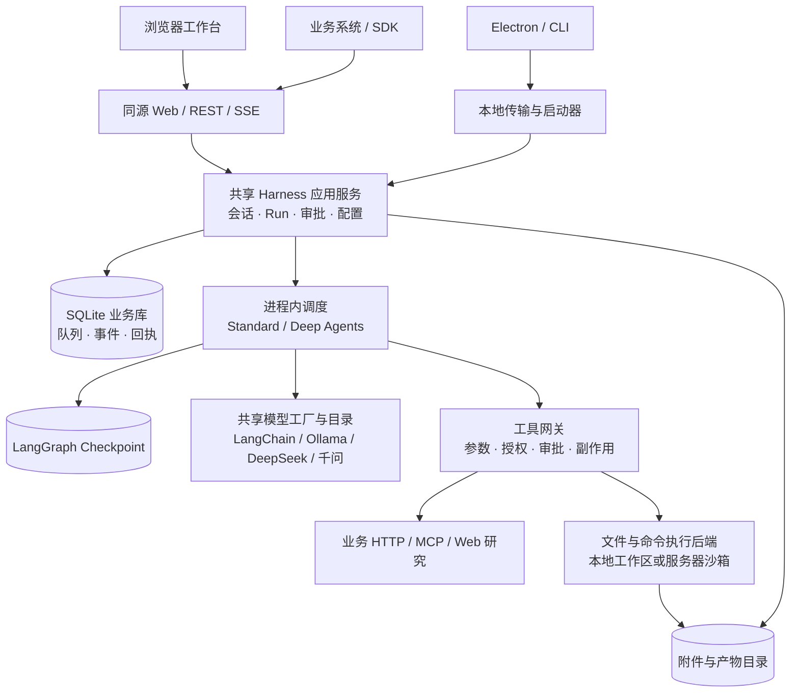
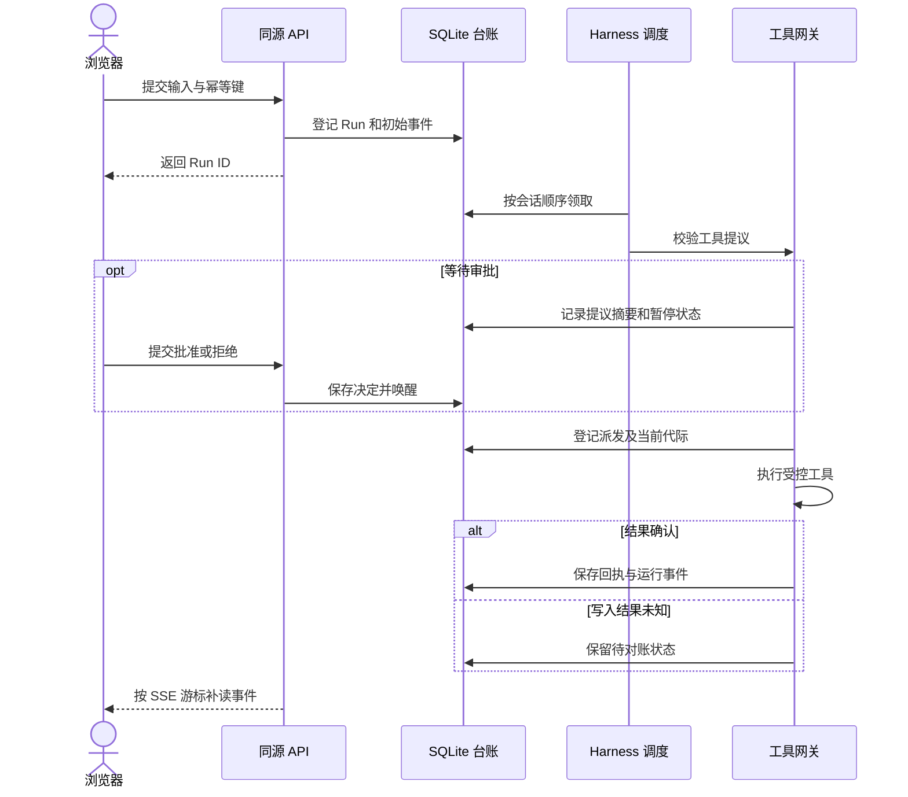

# deep-harness 免登录通用 Agent Harness 规划

本文记录服务器 Web、实例级多模型、业务扩展与隔离执行的总体设计。具体模块、启动和 API 见[实现规格](IMPLEMENTATION_SPEC.md)，运行与部署现状见[开发状态](DEVELOPMENT.md)。

[落地实现规格](IMPLEMENTATION_SPEC.md)给出配置、接口、数据模型、故障恢复和验收用例。

## 1. 产品边界

**一个实例，一个共享操作空间。** 浏览器打开服务器地址即可使用。连接到同一 Web 实例的浏览器和 API 客户端共享会话、模型目录、任务、审批和产物。多个浏览器标签页可以同时使用。本机 CLI 与 Electron 使用各自启动参数配置的本地宿主。工具审批用于审阅具体操作，批准者可以是同一 Web 实例的任意操作者。

| 形态 | 启动方式 | 文件与状态位置 |
| --- | --- | --- |
| 本地 CLI / Electron | 使用现有 Python 宿主和专用 Conda 环境。Electron 继续管理本机子进程连接。 | 本机状态目录、Ollama 或远程模型、操作者选择的本机工作区。 |
| 服务器 Web | 一个 Python 服务托管 React 静态页面和同源 REST/SSE。浏览器直接打开，无登录流程。 | 服务器状态卷、模型端点及已配置的服务器工作目录。浏览器上传的附件进入服务器产物目录。 |
| 业务嵌入 | 通过 REST/SSE 调用已有实例，或运行独立实例并挂载自定义业务工具。 | 业务数据由连接器持有，平台保存本次调用的最小必要证据、产物和运行状态。 |

默认监听回环。需要远程访问时，部署者明确选择可信网络路径，例如内网、SSH 隧道或私有网络入口。经反向代理发布时由代理提供 HTTPS，浏览器与 API 保持同源。实例的可达范围就是其访问边界。应用保持免登录，公网开放会把实例的会话、审批、配置和工具操作能力暴露给可达方。

## 2. 目标架构



架构图中的应用服务是共享实现。本地和服务器分别创建各自的宿主和状态目录。**首版服务器一个 Python 进程、一个持久状态卷、一个 owner。** API 与运行任务共享事件循环，模型和工具使用有界异步调用。进程退出由服务管理器重启，任务恢复由台账负责。首版沿用 SQLite 业务库和 checkpoint，运行只允许单副本持有状态卷。独立 Worker、PostgreSQL 和外部对象存储等在出现对应部署需求后再评估。

## 3. 实例级配置与领域对象

| 对象 | 作用 |
| --- | --- |
| InstanceConfig | 实例监听、数据目录、默认模型、可用工作目录、执行模式、并发和用量预算。部署配置由运行入口加载。 |
| WorkspaceRef | 一个已配置的本地目录、服务器工作目录或受管临时目录。一个会话使用选定目录，Agent 定义可跨目录复用。 |
| ModelDefinition | 可选模型的适配器类型、地址、型号、超时、连接凭据引用、能力及配置修订。 |
| AgentDefinition / Workflow | 具名配置，声明指令、工具、模型要求、输入输出、预算与验收方式。发布或更新后产生修订。 |
| Session / Run | Session 保存对话和冻结配置。Run 沿用现有 admission 语义，为一次输入或任务执行保存幂等键、代际、预算和状态。 |
| Approval / EffectReceipt / Artifact | 已审阅提议、派发与结果、附件和输出文件分别记录，通过 Run 和稳定 ID 关联。 |

服务器支持实例配置的命名目录，例如 workbench、read-only-reference 或临时目录。浏览器通过目录 ID 选择，宿主负责路径解析和执行范围校验。使用无文件工具的 Agent 可运行在空的受管目录。为首版复用现有 Profile 绑定，可用实例配置为每个注册目录生成内部 Profile，Web 界面只展示工作目录。后续视需要把 Profile 中的目录绑定和状态分区拆开。

模型、Agent、工具和流程配置可以先由部署者维护 YAML，启动校验并在 Web 只读展示。模型和 Agent 的在线编辑可在 UI 具备修订校验和审计后加入。模型密钥和业务连接器密钥由环境或独立 secret 文件提供，浏览器看到掩码或引用状态。服务端受管配置对模型和工具输出保持不可写。

## 4. 模型接入继续使用 LangChain

**首版只需要共享模型工厂、实例模型目录和会话绑定。** 从 CLI 的模型构造分支提取工厂。Ollama 继续使用 ChatOllama，标准兼容端点使用 ChatOpenAI，第三方协议特性优先通过对应 LangChain 集成适配。DeepSeek、千问、Ollama 或自定义推理端点填写已支持的适配器和能力配置。

- 浏览器创建会话时提交 model_id，宿主解析到具体模型配置修订并冻结。改变实例默认模型只影响以后的会话。显式换模型可新建会话或创建新绑定的分支。
- 文本、工具调用、流式工具参数、结构化输出、上下文窗口按实际模型登记和验证。仅支持文本的模型可以运行纯对话。要求工具能力的 Agent 在创建时校验配置，避免执行中才发现能力不足。
- Standard 与 Deep 分别继续走现有调用入口，共用模型配置、超时、预算、错误分类和用量语义。所有供应商接入都测试完整工具往返。供应商所需的私有会话状态由适配器处理，普通日志和浏览器事件展示可公开的响应字段。
- 首版把实例级模型并发和用量计数留在现有进程。动态选模、供应商自动切换和独立网关服务属于后续选择。

参考 [LangChain 模型接口](https://docs.langchain.com/oss/python/langchain/models)、[DeepSeek 思考模式](https://api-docs.deepseek.com/guides/thinking_mode/)和[千问工具调用](https://www.alibabacloud.com/help/en/model-studio/qwen-function-calling)。

## 5. Web、调度与恢复



1. **保持现有执行语义。** 会话内串行领取，跨会话采用实例并发上限和有界模型槽。审批等待释放活动槽。并发写入同一受管目录时，可先按目录串行化，或各自使用独立工作区。
2. **浏览器断开独立于运行。** 持久化初始事件后返回 Run ID。重连走 SSE 游标或查询快照，接收方按事件 ID 去重。取消是显式命令。相同输入幂等键与参数匹配时返回原记录，冲突时返回 409。
3. **继续保护未知写入。** 保留工作归属、代际、提议摘要、批准及派发记录。已派发且结果未知的写操作进入对账，重启和浏览器重连无需重发。连接器有可验证幂等或状态查询时，通过同一外部操作号核实。
4. **Web 路由。** 参考现有会话 API，提供模型目录、Agent 和目录列表、会话、提交输入、事件、审批、取消和产物。Web 页面与 API 同源，限制跨源请求，校验 Host 及浏览器变更请求的 Origin，使用 JSON 请求并拒绝表单代替状态变更。SSE、附件与产物下载保持同一实例边界。
5. **区分网络入口。** 当前 Electron 的本机 Bearer token 用于进程握手和回环接口保护。Web 模式另装配免登录 API。Web 页面不依赖 Electron preload、本机 token 或本机路径能力。

## 6. 通用业务扩展

业务接入以 **Agent 定义 + 工具 + 工作流 + 验收器** 为核心。先从稳定的小契约开始，业务方可以只提供其中所需部分。

| 扩展 | 首期接口 |
| --- | --- |
| Agent 定义 | YAML 引用指令、模型或模型要求、已注册工具、输入输出 schema、工作目录需求和预算。 |
| 工具 | 内置 Python 工具、受控 HTTP 调用或配置的 MCP。声明 ID、版本、输入输出、是否修改状态、超时、审批、幂等与可选对账方法。 |
| 工作流 | 优先复用现有长任务的阶段、预算、交接和检查。再加确定性校验、审批步骤、条件及产物传递。 |
| 验收器 | 验证实际文件、JSON、命令退出码或业务系统的最终状态。执行、报告和验收各有状态。 |
| 业务集成 | 首版发布 REST/SSE、配置示例与工具契约。SDK 在 API 稳定后提供薄封装，自定义 UI 可以独立实现。 |

**示例。** 采购助手通过只读工具读取供应商和采购制度并生成草稿，验证器检查必填字段和金额。操作者在 Web 审阅参数后批准提交，连接器带 effect ID 创建记录。若服务断开，状态查询工具用该标识对账。把采购工具换成工单或知识检索工具时，平台继续使用原有运行、审批、产物和证据机制。

```yaml
agents:
  - id: procurement-review
    model: main-model
    required_capabilities: [tool_calls]
    tools: [supplier.lookup, policy.search]
    workflow: procurement-draft
workflows:
  - id: procurement-draft
    steps:
      - id: draft
        type: agent
      - id: verify
        type: verify
        input_from: draft
        verifier: purchase.validate
      - id: submit
        type: tool
        tool: purchase.submit
        input_from: verify
        approval: required
        on_unknown: reconcile
```

上述为拟议的配置。发布前检查工具引用、模型能力和阶段输出。提交参数绑定到通过验证的产物与审批摘要。业务规则由目标系统校验，业务连接器得到独立、受限的凭据。

## 7. 服务器工具、文件与部署

- **默认工具集。** 服务器试点先启用只读工作区、已配置的检索与明确注册的业务工具。原生宿主 Shell 保留在本地模式。服务器需要任意代码或命令时接入隔离执行器，显式约束工作目录、文件挂载、网络、进程树、CPU、内存、时间和输出。
- **文件与产物。** 首版使用实例状态卷中的私有目录，按随机产物 ID 提供上传和下载。限制文件大小与类型，校验目标路径，写入后保存摘要和来源。模型工具只能访问获准目录或挂载。服务器命令只能看到服务器工作区，浏览器本地文件依赖显式上传。
- **部署。** 首版可用单机服务或单容器运行，同一实例的业务库、checkpoint、配置与产物分别归档并一同恢复。用健康检查、结构化日志、并发上限和 graceful shutdown 管理运行；配置好模型地址、持久卷、密钥引用和受信网络入口。
- **扩展门槛。** 如果之后确有多进程调度、数据库写入竞争或远程存储需求，再拆独立 Worker 和租约存储。保留工具审批与回执契约，避免部署拓扑变化改变重放语义。

## 8. 新增与修改模块

| 操作 | 模块 | 改造 |
| --- | --- | --- |
| 修改 | [bootstrap.py](src/deep_harness/bootstrap.py)、[配置加载](src/deep_harness/application/config.py) | 拆出共享宿主装配、本地入口和 Web 入口。复用生命周期、持久队列和 Profile owner。新增实例配置与命名工作目录。 |
| 修改 / 新增 | [CLI 模型构造](src/deep_harness/cli.py)、[模型包装](src/deep_harness/runtime/models.py)、runtime/model_factory.py、application/model_catalog.py | 提取共享 LangChain 工厂，增加模型目录和显式模型配置。保留诊断模型供测试。 |
| 修改 | [会话快照](src/deep_harness/application/session_runtime.py)、[Standard](src/deep_harness/runtime/standard.py)、[Deep 守卫](src/deep_harness/runtime/guard.py) | 会话绑定所选模型版本。统一预算、错误和用量语义。在暂停恢复时重建对应模型客户端。 |
| 修改 / 新增 | [本机 API](src/deep_harness/transports/api.py)、transports/web.py、web/、[桌面组件](desktop/src) | 抽出共享路由和事件 DTO，新增同源 Web 服务、浏览器传输适配器和 React 入口。现有 CLI 和 Electron 继续可用。 |
| 修改 / 新增 | [工具网关](src/deep_harness/application/tools.py)、[长任务](src/deep_harness/application/jobs.py)、application/agent_definitions.py、tool_registry.py、verification.py | 添加具名可版本化 Agent、工具 schema、业务连接器与确定性验收。沿用审批、派发和对账。 |
| 新增 | runtime/executor/、infrastructure/connectors/、infrastructure/artifacts.py | 执行后端、受控业务接入、附件和产物。服务器代码执行通过隔离能力验收后启用。 |
| 修改 | [BusinessStore](src/deep_harness/infrastructure/store.py)、[执行台账](src/deep_harness/infrastructure/executions.py)、[归档](src/deep_harness/infrastructure/archives.py) | 为新增定义及产物登记补齐持久化。验证同一实例单 owner、并发和恢复。保持首版 SQLite。 |
| 新增 | deploy/、examples/、可选 sdk/ | 单实例部署示例、第二业务样例、API 调用示例及小型 SDK。 |

## 9. 实施顺序和验收

| 阶段 | 交付 | 验收 |
| --- | --- | --- |
| 1. 共享内核与多模型 | 提取模型工厂和宿主装配，增加实例目录、会话模型绑定和测试。 | 本地三入口可用。Ollama、DeepSeek、千问配置完成文本和所需工具往返。两个会话可绑定不同模型，恢复时读取原绑定。 |
| 2. 免登录 Web 只读试点 | 单进程托管 Web，同源 API/SSE，工作目录选择与只读 Agent。 | 在受信部署入口直接进入界面。模型可选，浏览器断线后可续读。两个标签页并发提交仍遵守会话 FIFO 和实例预算。 |
| 3. 业务工具和产物 | 登记 HTTP/MCP 工具、一个带审批的写入、对账、产物与验收。 | 同一写请求不会因重复提交重复派发。故障注入后未知写入停住。实际结果可验证。第二个业务可通过配置和工具接入。 |
| 4. 服务器隔离执行 | 独立任务工作区、命令沙箱、资源限制和差异审阅。 | 验证写入范围、网络、子进程、取消清理、源工作树完整性和成果可复核。 |

第一条可上线链路为**打开服务器地址 → 选模型和 Agent → 运行只读任务 → 断线重连 → 查看带来源的结果**。第二条链路加入一个可对账的业务写入。先用这两条链路验证通用工作流，再决定是否扩展运行拓扑。
